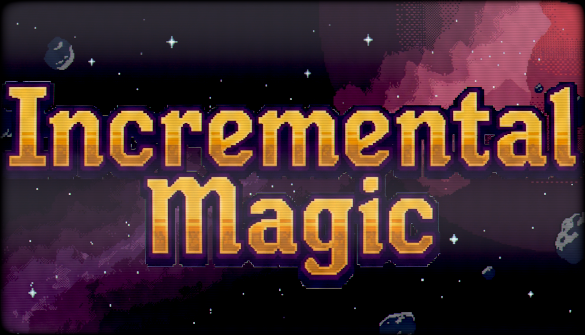
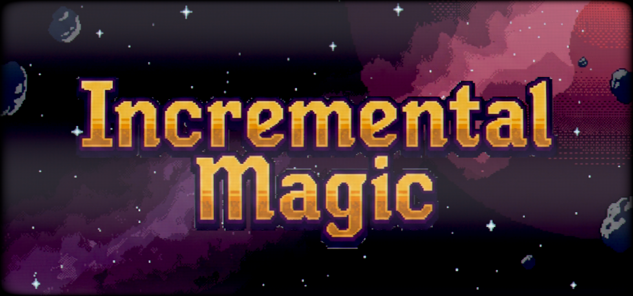
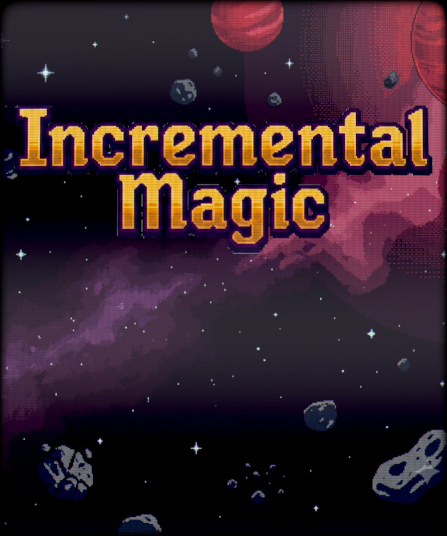
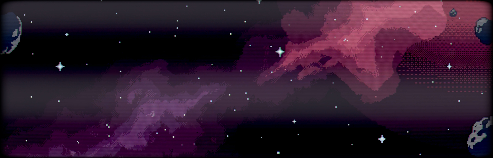
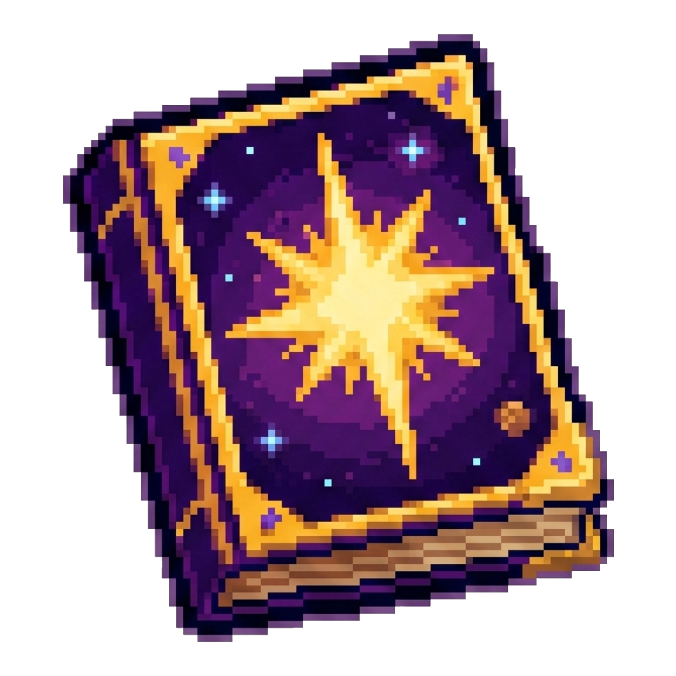
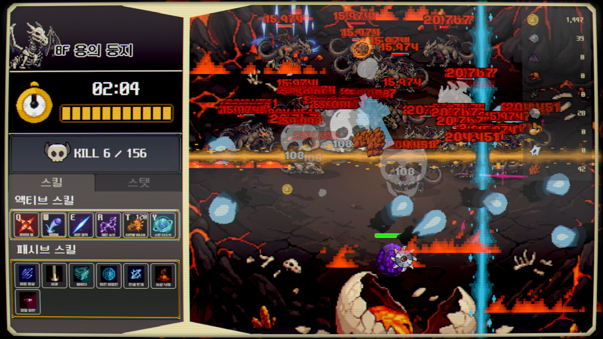
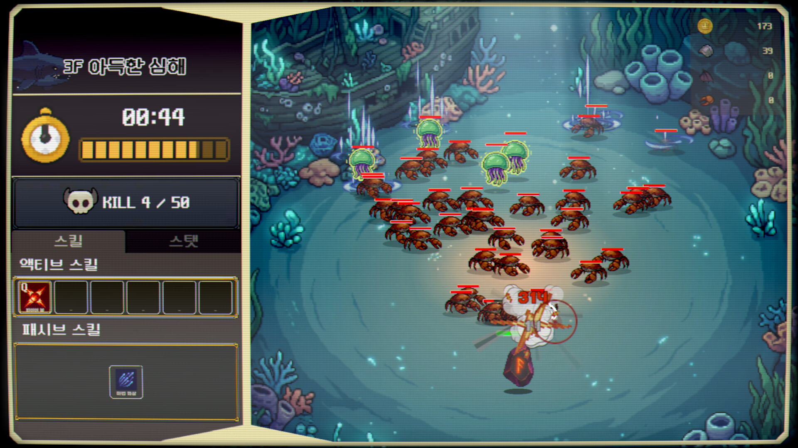
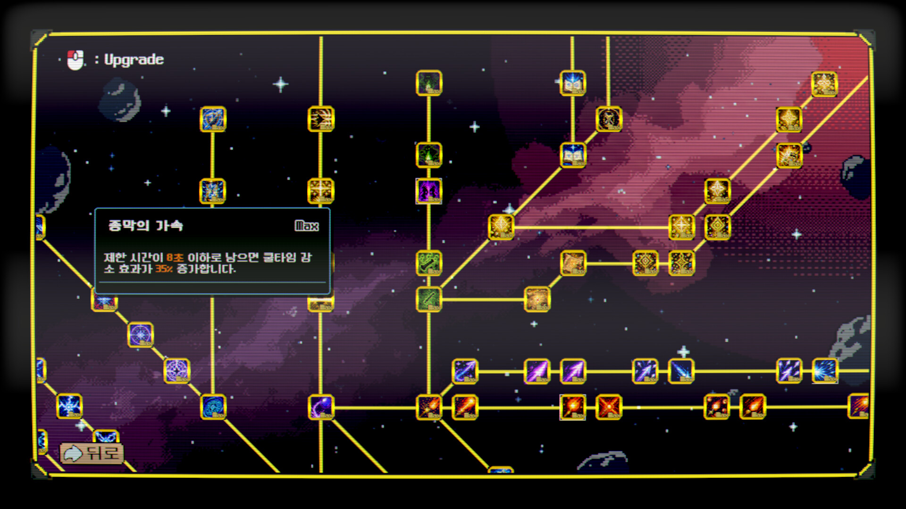
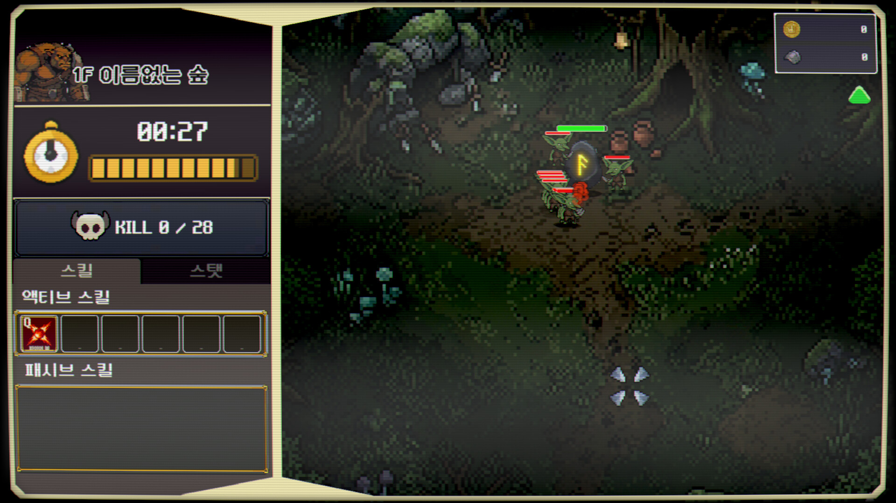
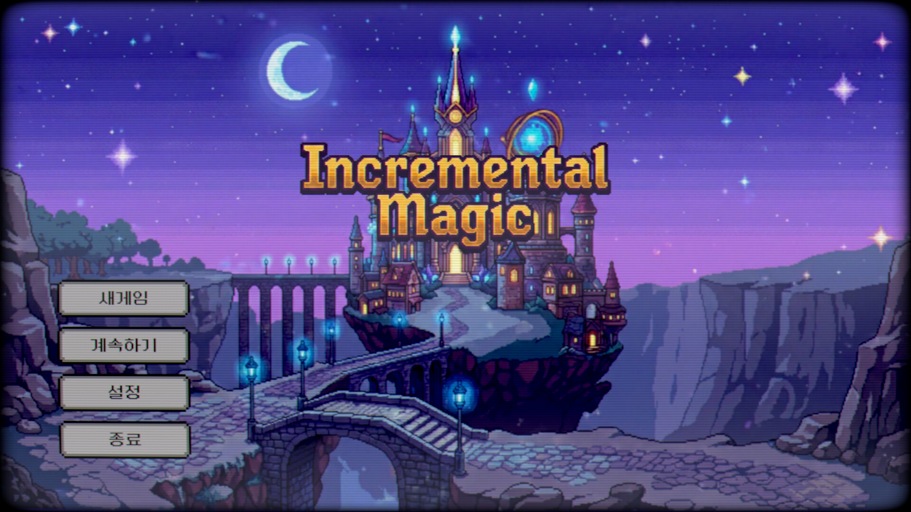

# Incremental Magic — Press Kit

> **The action clicker you actually aim.**
> A free demo is available now on Steam.

**[Download all logos, key art & screenshots (.zip)](./assets/incremental-magic-presskit.zip)** · [Steam page](https://store.steampowered.com/app/4928970/?utm_source=presskit&utm_medium=web&utm_campaign=nextfest_outreach) · [Discord](https://discord.gg/wmAAtPDkkC)

---

## Fact Sheet

| | |
|---|---|
| **Title** | Incremental Magic |
| **Developer** | Natural Nomad (solo developer, South Korea) |
| **Release Date** | Q4 2026 |
| **Demo** | Free demo available now on Steam · Steam Next Fest, October 19–26, 2026 |
| **Price** | TBA (demo: free) |
| **Platform** | Windows (Steam) |
| **Genre** | Action Clicker / Incremental |
| **Languages** | English, 한국어, 日本語, 简体中文, 繁體中文, Español, Português (BR), Русский, Deutsch, Français, Italiano, Polski, Türkçe, Українська |
| **Steam** | <https://store.steampowered.com/app/4928970> |
| **Discord** | <https://discord.gg/wmAAtPDkkC> |
| **Press Contact** | natural.nomad.26@gmail.com |

## Description

Incremental Magic is a 2D action clicker where you click, drag, and scroll to hunt monsters yourself with your mouse. Aim your skills to break the bosses of 8 dungeons, and grow your skill tree into a build of your own. Not idle — aim, shoot, smash.

클릭하고 드래그하고 스크롤하며 마우스로 직접 몬스터를 잡는 2D 액션 클리커. 스킬을 겨냥해 8개 던전의 보스를 격파하고, 스킬트리를 키워 나만의 빌드로 강해진다. 켜두고 자는 방치형이 아니다 — 노리고, 쏘고, 부순다.

## Key Features

- **Aim Every Skill With Your Mouse** — click to unleash, drag and scroll to command the fight. Where you aim and when you strike is the skill.
- **8 Dungeons, 8 Bosses** — Nameless Forest → Hidden Cave → Distant Abyss → Abandoned Cemetery → Quiet Meadow → Desert of Death → Spirit Realm → Dragon's Nest, each ending in its own boss with a cinematic intro.
- **16 Skills, Active and Passive** — 8 active skills you aim yourself and 8 passives that fire on their own; mix them into your own build.
- **A Permanent Skill Tree** — every run feeds a branching tree that carries over, and the stronger you get, the deeper the dungeons open.
- **Not Idle** — no waiting, no offline timers. Short, punchy runs built around the "one more upgrade" loop.
- **14 Languages** at launch.

## Trailer

Watch the trailer on the [Steam page](https://store.steampowered.com/app/4928970/?utm_source=presskit&utm_medium=web&utm_campaign=nextfest_outreach).

## Logo & Key Art

Click an image to open the original file, or grab everything in the [.zip](./assets/incremental-magic-presskit.zip).

| | |
|---|---|
|  | **Logo** — transparent PNG, 1280×720 [Download](./assets/logo_1280x720.png) |
|  | **Key art (main)** — 1232×706 [Download](./assets/keyart_main_1232x706.png) |
|  | **Key art (header)** — 920×430 [Download](./assets/keyart_header_920x430.png) |
|  | **Key art (vertical)** — 748×896 [Download](./assets/keyart_vertical_748x896.png) |
|  | **Key art without logo** — 3840×1240, for thumbnails [Download](./assets/keyart_hero_3840x1240.png) |
|  | **Icon** [Download](./assets/icon.png) |

## Screenshots

1920×1080. Click an image to open the original file.

| | |
|---|---|
|  |  |
|  |  |

## About the Developer

Natural Nomad is a solo indie developer from South Korea. Incremental Magic is the studio's second Steam game, after the free poker roguelike deckbuilder Board Poker (July 2026).

한국의 1인 인디 개발자입니다. Incremental Magic 은 무료 포커 로그라이크 Board Poker 에 이은 두 번째 스팀 게임입니다.

## Usage

All assets on this page may be used freely for coverage of Incremental Magic. Streaming and video monetization are fully permitted. The in-game music and sound effects are licensed royalty-free and are not registered with YouTube Content ID.

Contact: natural.nomad.26@gmail.com
