# Plinko Squad — Press Kit

> **Your army comes out of a plinko board.**
> A roguelite auto battler. Free demo coming to Steam.

[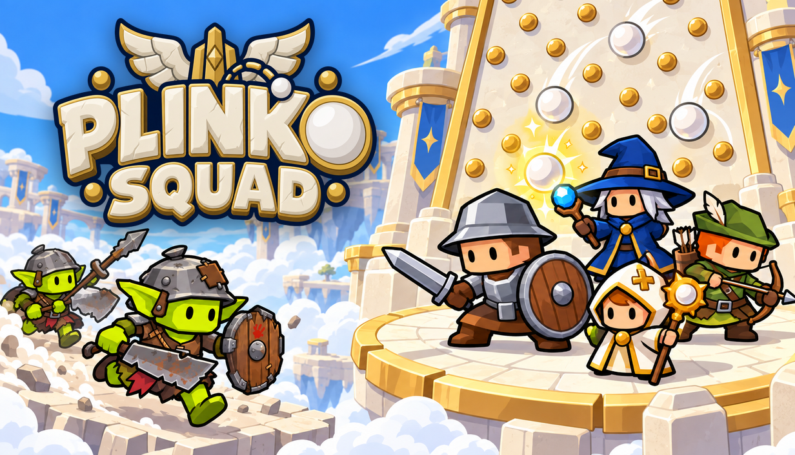](./assets/keyart_main_1232x706.png)

**[Download all logos, key art & screenshots (.zip)](./assets/plinko-squad-presskit.zip)** · [Steam page](https://store.steampowered.com/app/5324330/?utm_source=presskit&utm_medium=web) · [Discord](https://discord.gg/KYamXevqhJ)

---

## Fact Sheet

| | |
|---|---|
| **Title** | Plinko Squad |
| **Developer** | Natural Nomad (solo developer, South Korea) |
| **Release Date** | TBA |
| **Demo** | Free demo, TBA |
| **Price** | $9.99 (demo: free) |
| **Platform** | Windows (Steam) |
| **Genre** | Roguelite / Auto Battler / Strategy |
| **Languages** | English, 한국어, 日本語, 简体中文, 繁體中文, Español, Español (Latinoamérica), Português (BR), Русский, Deutsch, Français, Italiano, Polski, Türkçe, Українська, Nederlands, Svenska, Dansk, Norsk, Suomi |
| **Steam** | <https://store.steampowered.com/app/5324330> |
| **Discord** | <https://discord.gg/KYamXevqhJ> |
| **Press Contact** | natural.nomad.26@gmail.com |

## Description

Drop balls down a plinko board to recruit your squad, arrange them on a hex grid, and send them auto-battling up a 25-floor tower. Stack augments into explosive synergies, but every unit that falls is gone for good.

플링코 판에 공을 떨어뜨려 스쿼드를 모으는 로그라이트 오토배틀러입니다. 유닛을 육각 진형에 배치하면 전투는 알아서 벌어지고, 스쿼드는 탑을 한 층씩 올라 25층 꼭대기를 노립니다. 증강을 쌓아 폭발적인 시너지를 만들어 보세요. 단, 전투에서 쓰러진 유닛은 영영 돌아오지 않습니다.

## Key Features

- **Plinko recruiting** — every ball bounces down the board, lands in a slot and brings in a new recruit. Drop as fast as you like.
- **Hex-grid auto battles** — five classes (warrior, archer, rogue, mage, priest). Set the formation, then watch the fight play out.
- **Merge and synthesize** — merge identical units to level them up, and combine classes into heroes.
- **Augment synergies** — one augment is a bonus; the right few together break the run wide open.
- **Climb the tower** — shop, drop, fight, collect, one floor at a time, with a boss every four floors up to floor 25.
- **Permadeath squad** — units that fall in battle are gone for good.

## Trailer

TBA

## Logo & Key Art

Click an image to open the original file, or grab everything in the [.zip](./assets/plinko-squad-presskit.zip).

| | |
|---|---|
| [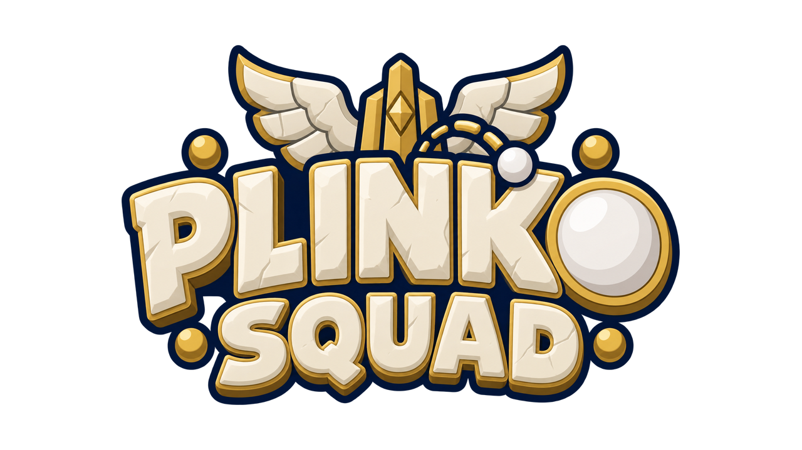](./assets/logo_1280x720.png) | **Logo** — transparent PNG, 1280×720 [Download](./assets/logo_1280x720.png) |
|  | **Key art (main)** — 1232×706 [Download](./assets/keyart_main_1232x706.png) |
| [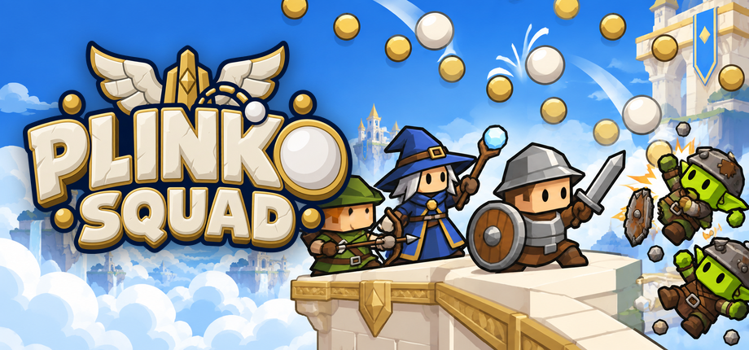](./assets/keyart_header_920x430.png) | **Key art (header)** — 920×430 [Download](./assets/keyart_header_920x430.png) |
| [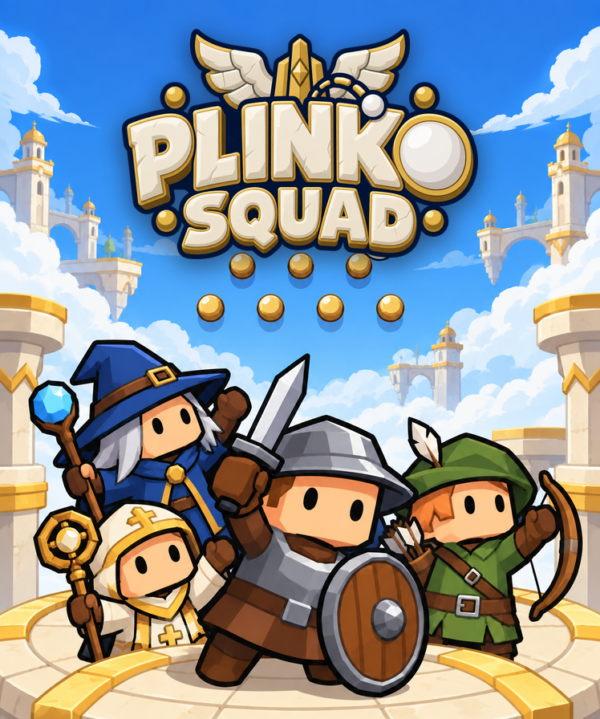](./assets/keyart_vertical_748x896.png) | **Key art (vertical)** — 748×896 [Download](./assets/keyart_vertical_748x896.png) |
| [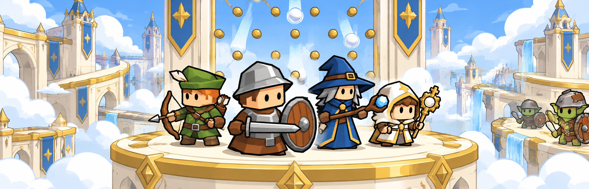](./assets/keyart_hero_3840x1240.png) | **Key art without logo** — 3840×1240, for thumbnails [Download](./assets/keyart_hero_3840x1240.png) |
|  | **Icon** — 1024×1024 [Download](./assets/icon.png) |

## Screenshots

1920×1080. Click an image to open the original file.

[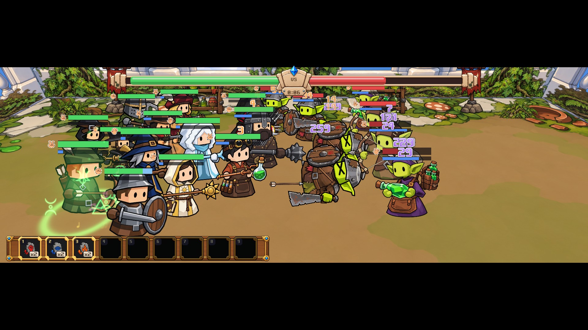](./assets/screenshot_01.jpg)

| | |
|---|---|
| [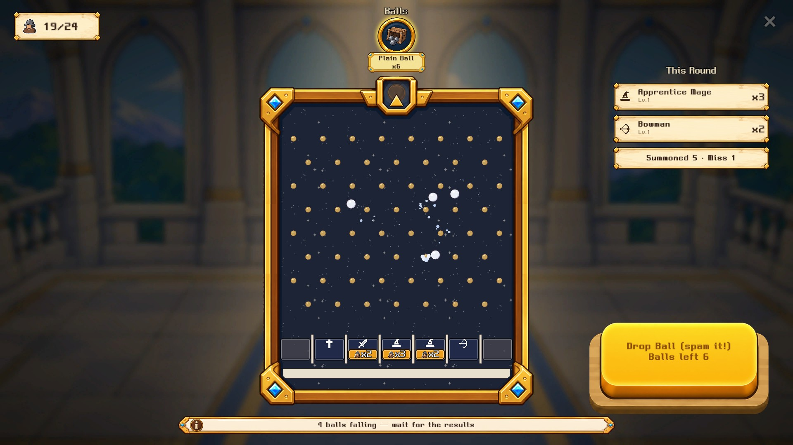](./assets/screenshot_02.jpg) | [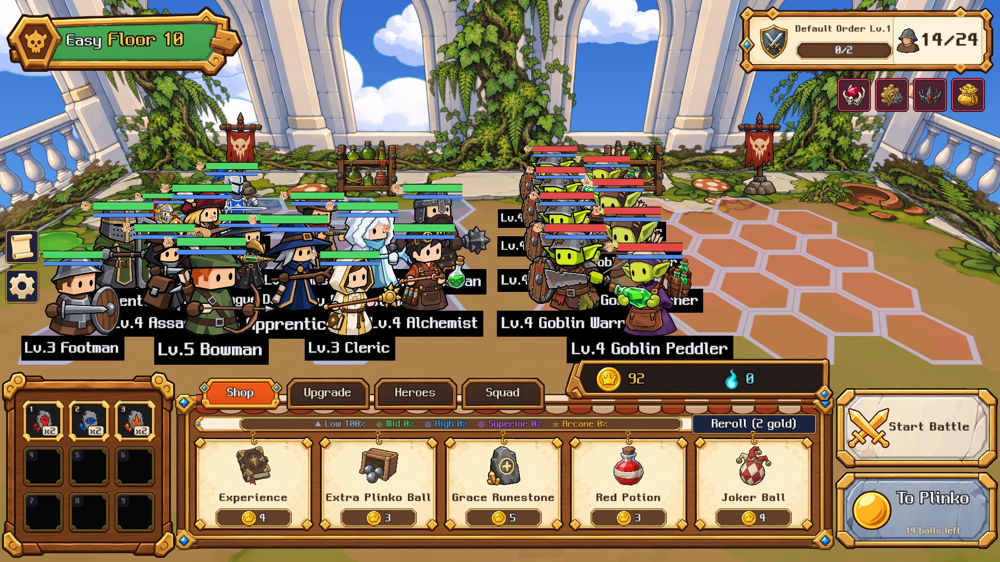](./assets/screenshot_03.jpg) |
| [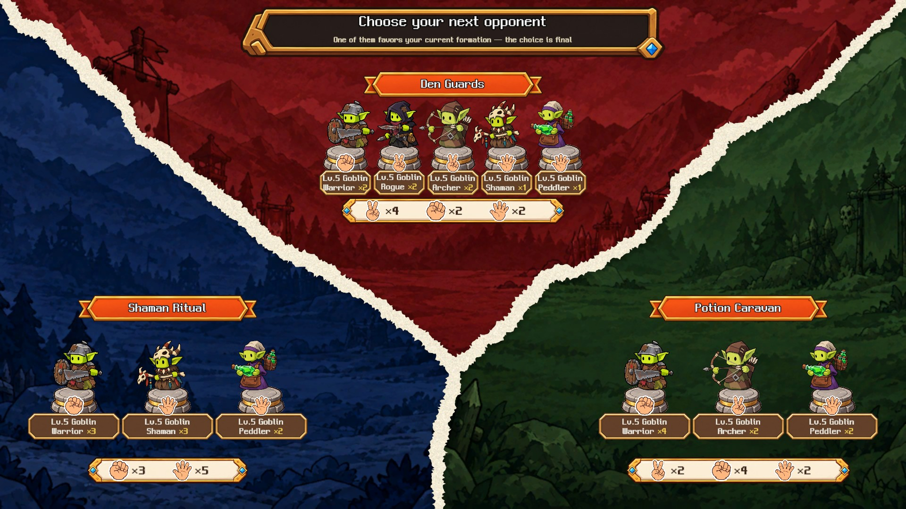](./assets/screenshot_04.jpg) | [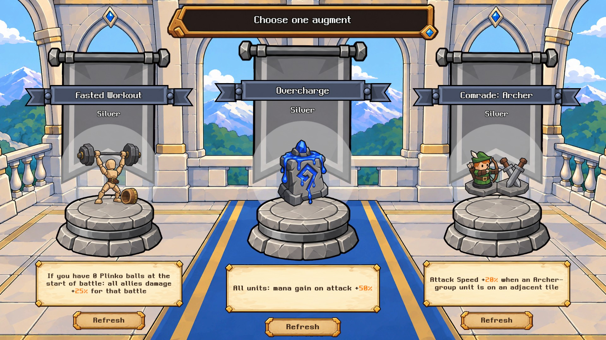](./assets/screenshot_05.jpg) |
| [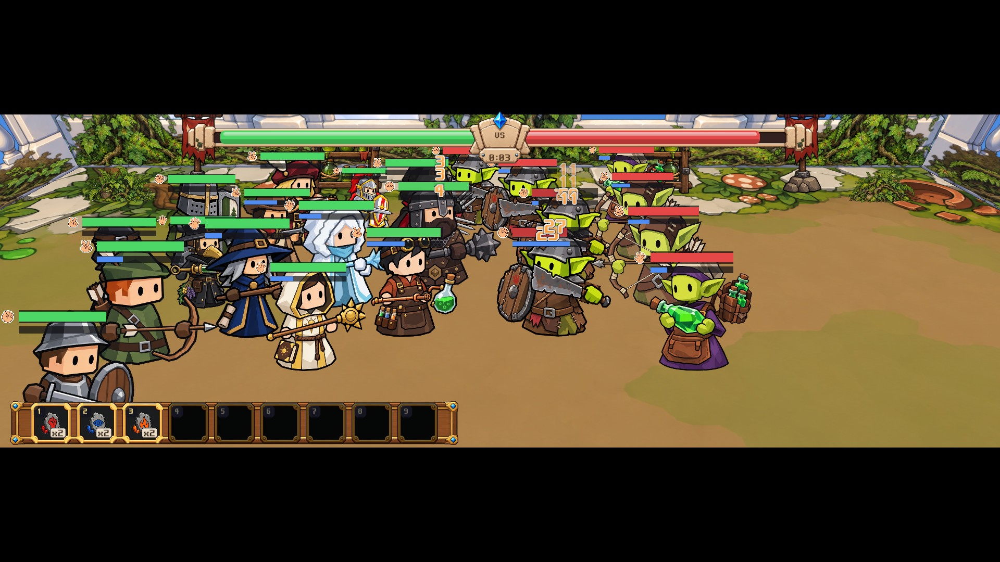](./assets/screenshot_06.jpg) | |

## About the Developer

Natural Nomad is a solo indie developer from South Korea.

한국의 1인 인디 개발자입니다.

## AI Disclosure

Character art, UI graphics and icons were created with generative AI image tools, and background music with generative AI music tools; both were then selected and edited by the developer. Some in-game text, translations and store page text were drafted with AI assistance and reviewed by the developer. Nothing is generated by AI while you play. See also the AI Generated Content Disclosure on the Steam page.

## Usage

All assets on this page may be used freely for coverage of Plinko Squad. Streaming and video monetization are fully permitted.

Contact: natural.nomad.26@gmail.com
